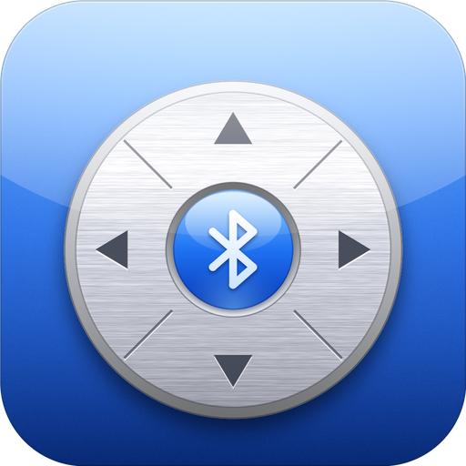
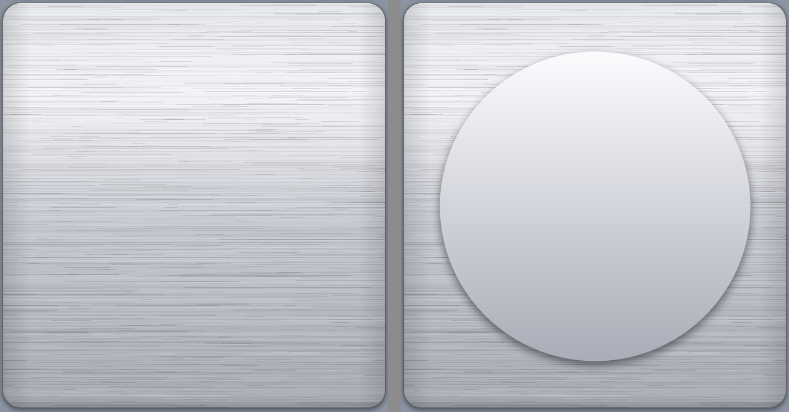

# Bluemote

Turn a jailbroken iPhone into a **Bluetooth trackpad, keyboard and TV remote**. The iPhone pairs with a TV, tablet or
computer the same way a real Bluetooth keyboard does, so no companion app is needed on the other side.

<p align="center">
  
</p>

* **Trackpad**: move, tap, right-click, two-finger scroll in any direction, tap-and-drag.
* **Media remote**: D-pad with a real **OK / Select** key (tap = click, hold = long press), volume and channel rockers,
  Back / Home / Menu, transport keys, Mute, and a *Reels / Shorts* mode.
* **Keyboard**: the iOS keyboard plus Esc, Tab, arrows, F-keys, one-shot Ctrl / Shift / Alt / Win, and **Paste** (types
  your clipboard on the TV).
* **Automatic pairing**: no passcode on either side (Secure Simple Pairing "Just Works"), like any Bluetooth keyboard.
* **Built-in BTstack**: the Bluetooth stack and daemon are compiled from source inside this project; nothing in
  `/usr/lib` is replaced.

> **Status:** hobby project. It targets one specific old device (see below). Read [Compatibility](#compatibility)
> before you spend time on it.

## Compatibility

**Phone (the app runs on):** a **jailbroken iPhone 4s on iOS 6.x**. This is what the project is built for: the Makefile
targets the iOS 6.1 SDK, `armv7`, minimum iOS 6.0, and the Bluetooth code drives the 4s's Broadcom chip directly.

* Other 32-bit iPhones (4, 3GS) *might* work in theory; nothing here is verified for them.
* iOS 7 and later, and 64-bit iPhones, are **not supported**: the app replaces iOS's Bluetooth daemon, and the iOS port
  of BTstack it builds on does not carry over.
* A jailbreak is required: the daemon runs as root and takes the Bluetooth chip away from iOS while the app is open.

**Host (the TV or computer you control):** anything that accepts a standard Bluetooth HID keyboard, mouse and consumer
control (media keys). Developed against **Android TV / Google TV** (including Gboard on the TV).

| Host | Expected |
| --- | --- |
| Android TV, Google TV, Fire TV | works (Android TV is what it is developed against) |
| Android phone / tablet, Windows, Linux | should work, standard HID |
| Apple TV, Samsung / LG smart TVs, game consoles | often reject generic Bluetooth keyboards or mice; not expected to work |

"Expected" means the protocol is standard, not that every device has been tested.

## Install

Build on the phone with [Theos](https://theos.dev/) and the **iOS 6.1 SDK**.

```sh
git clone https://github.com/shafqatautosupply-sketch/bluemote
cd bluemote
sudo chown -R mobile:mobile .      # build as the mobile user
make package install               # installs the app and loads the launchd job; no respring needed
```

Then **turn the iOS Bluetooth switch OFF** and open *Bluemote*. If the status line says *"BTstack daemon not running"*:

```sh
cat /var/log/Bluemote.log
launchctl list | grep bluemote
```

The package installs the app, `/usr/bin/BluemoteDaemon` and a launchd job (`/Library/LaunchDaemons/com.bluemote.BTdaemon.plist`).
It can sit next to the Cydia BTstack package, but only one daemon can drive the Bluetooth chip at a time: uninstall the
Cydia one if both try to start.

## Pair with a TV

1. In Bluemote open **Settings > Pairing & Devices > Pair new device** (the phone becomes discoverable).
2. On the TV open Bluetooth settings, add a device and choose the iPhone.
3. It pairs by itself; no code is shown. Bluemote reconnects to the last device automatically on start.

Re-pairing after an update: **Forget saved devices**, remove the iPhone from the TV's Bluetooth list, pair again.
Details and the PIN fallback for older TVs: [docs/PAIRING.md](docs/PAIRING.md).

## Using it

| Where | What |
| --- | --- |
| Trackpad | drag = move, tap = click, two-finger tap = right click / Back, two-finger drag = scroll, tap then drag = drag & drop |
| Media, D-pad | tap an arrow (hold to repeat), centre = **OK** (hold = long press), roll your thumb across the ring to change direction |
| Media, gesture pad | swipe = arrows, tap = OK, hold = Back, two-finger tap = play / pause, two-finger drag up / down = volume, two-finger swipe left / right = previous / next, two-finger hold = Home, three-finger tap = mute |
| Keyboard | iOS keyboard, extra keys, **Paste** types the clipboard (about 35 to 40 characters per second) |

**Settings > Media remote:** media pad (D-pad or trackpad), **OK button** (*Select* = a real remote's OK, picks the highlighted
Gboard suggestion; *Enter* = keyboard Enter, fallback), Reels method and direction. Natural scrolling is under *Trackpad*.

### Screens

The trackpad, media pad and D-pad backdrop share one horizontally brushed aluminium slab. This is a render of that drawing
code (left: slab, right: with a mock D-pad ring), not a device screenshot:

<p align="center"></p>

## Project layout

```
.
├── Makefile                  Theos build: the app + the BTstack daemon
├── control                   Debian package metadata
├── layout/                   files installed as-is
│   ├── DEBIAN/               postinst / prerm (load and unload the launchd job)
│   └── Library/LaunchDaemons/com.bluemote.BTdaemon.plist
├── Resources/                Info.plist, icons, toolbar glyphs
├── main.m, AppDelegate.*     app entry
├── MainViewController.*      main screen, title bar, PIN / passkey prompt
├── TrackpadView.*            trackpad
├── MediaView.*               media remote: D-pad, rockers, gesture pad
├── KeyboardView.*            on-screen keyboard extras and Paste
├── SettingsViewController.*  settings
├── PairViewController.*      pairing and devices
├── UIHelpers.*               iOS 6 skin: glossy buttons, brushed aluminium slab, helpers
├── bluemote_core.*           Bluetooth HID device: commands, pairing, key / mouse / consumer reports
├── btstack/                  BTstack v1.2 subset, built from source (client library + iOS daemon)
├── tools/                    make_icon.py (icon generator), preview_slab.py (off-device slab preview)
└── docs/                     PAIRING.md, DEVELOPER_NOTES.txt, images
```

The app talks to the daemon over a unix socket (`/tmp/Bluemote`); the UI sends one-line text commands to the core
(`KEY`, `M`, `CLICK`, `MEDIA`, `OK`, `OKD`, `OKU`, `PAIR`, ...). The full list is at the top of `bluemote_core.c`.

## Tools

```sh
python3 tools/make_icon.py Resources   # regenerate the four icon PNGs (needs pillow, numpy, scipy)
python3 tools/preview_slab.py out.png  # render the aluminium slab off-device
```

## Troubleshooting

* **"BTstack daemon not running"**: see the log commands above; make sure iOS Bluetooth is off.
* **Stutter**: the BCM4330 shares its antenna with Wi-Fi; test with Wi-Fi off. Debug logging is off by default
  (see [docs/DEVELOPER_NOTES.txt](docs/DEVELOPER_NOTES.txt) to turn it on).
* **TV still asks for a code**: the TV does not support Secure Simple Pairing; type the code in the box the app shows.
* **OK does nothing on the TV**: set *Settings > Media remote > OK button* to *Enter*.
* **Old pairing stops working after an update**: forget the device on both sides and pair again.

More history and low-level notes: [docs/DEVELOPER_NOTES.txt](docs/DEVELOPER_NOTES.txt) and [CHANGELOG.md](CHANGELOG.md).

## Credits and licence

* **Bluemote's own code** (everything outside `btstack/`) is MIT licensed, see [LICENSE](LICENSE).
* **`btstack/`** is a trimmed copy of [BTstack](https://github.com/bluekitchen/btstack) v1.2 by BlueKitchen GmbH and is **not**
  MIT. It is free for **non-commercial / personal use only**; commercial use needs a licence from BlueKitchen (see the
  licence headers in each source file). Keep that in mind before redistributing a build commercially.
  Local changes to it are listed in `btstack/README-SUBSET.txt`.
